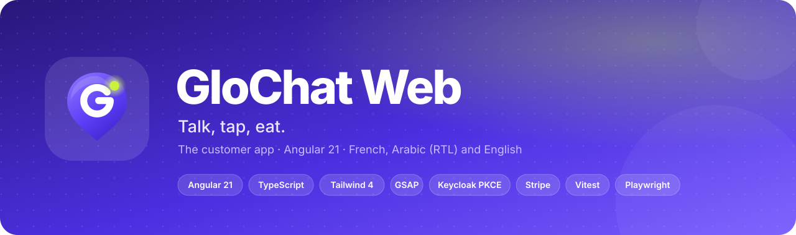
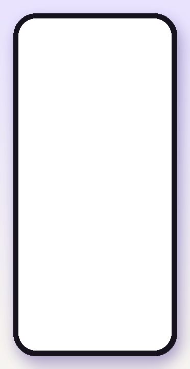
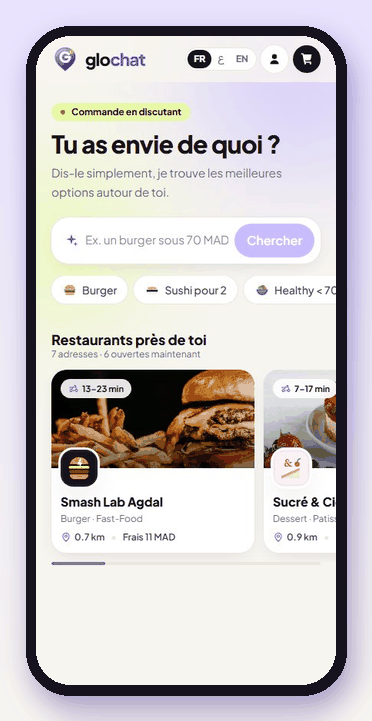
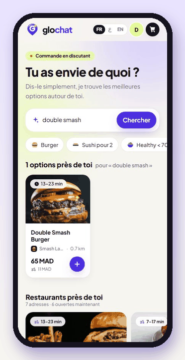
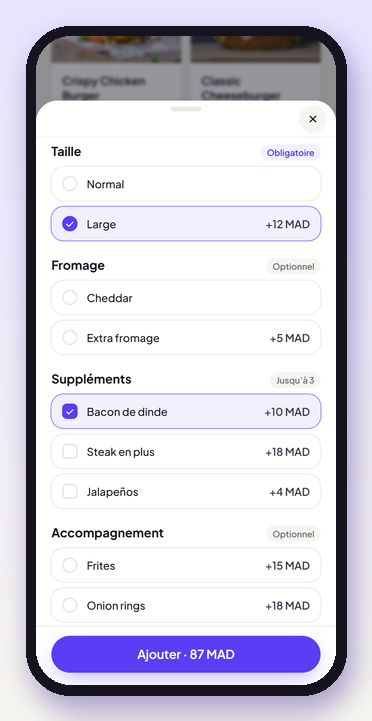
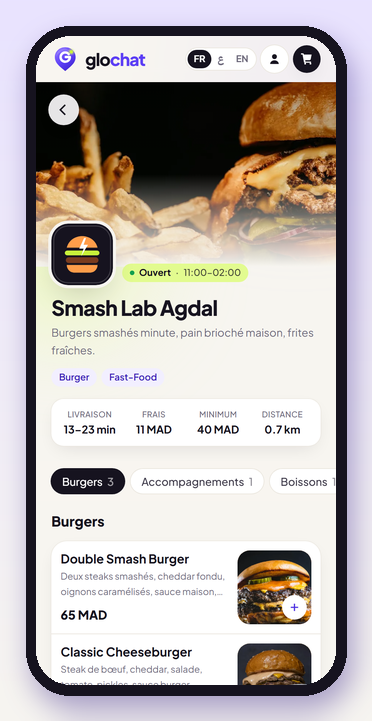
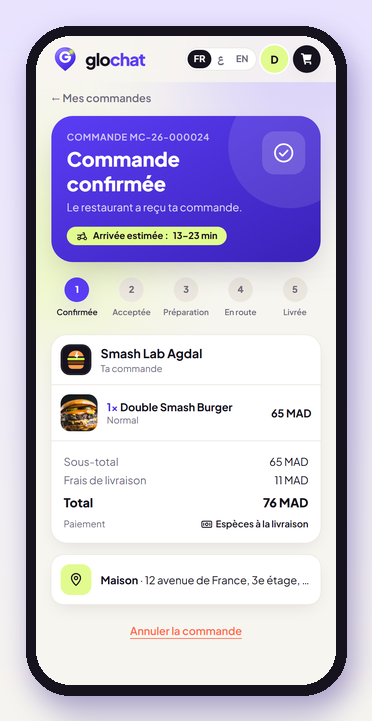
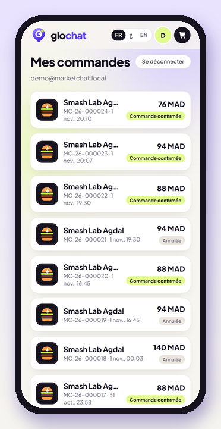
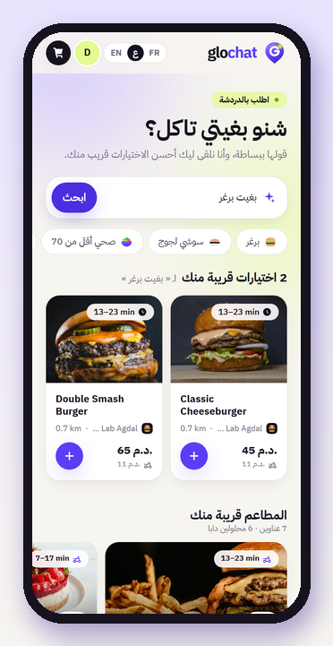
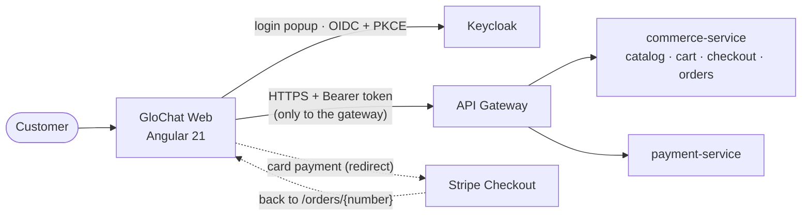

<div align="center">



<br/><br/>


**The customer app of GloChat: say what you feel like eating, pick, order — in French, Arabic or English.**

Backend (microservices, Kafka, Keycloak, Stripe): **[ISTIFANO/GloChat](https://github.com/ISTIFANO/GloChat)**

[Demo](#-demo) · [Features](#-features) · [How it works](#-how-it-works) · [Run it](#-run-it-locally) · [Configuration](#%EF%B8%8F-configuration) · [Tests](#-tests)

</div>

---

## 🎬 Demo

Recorded on the real stack — Keycloak login, the API gateway, PostgreSQL data, real orders.

<table>
  <tr>
    <th align="center">Welcome &amp; sign-in</th>
    <th align="center">Ask in plain words</th>
    <th align="center">Restaurants</th>
    <th align="center">Order</th>
  </tr>
  <tr>
    <td align="center"></td>
    <td align="center"></td>
    <td align="center"></td>
    <td align="center"></td>
  </tr>
  <tr>
    <td align="center"><sub>Branded splash, sign-in sheet<br/>over the shop</sub></td>
    <td align="center"><sub>"un burger sous 70" → results,<br/>options with live price</sub></td>
    <td align="center"><sub>Swipe (touch or mouse drag),<br/>merchant page with parallax</sub></td>
    <td align="center"><sub>Fly-to-cart, cart, price-locked<br/>checkout, confirmed order</sub></td>
  </tr>
</table>

<table>
  <tr>
    <td align="center"><br/><sub>Product options</sub></td>
    <td align="center"><br/><sub>Merchant page</sub></td>
    <td align="center"><br/><sub>Order tracking</sub></td>
    <td align="center"><br/><sub>Order history</sub></td>
    <td align="center"><br/><sub>Arabic (RTL)</sub></td>
  </tr>
</table>

---

## ✨ Features

| | |
|---|---|
| 💬 **Conversational search** | One composer: *"un burger sous 50"*, *"sushi pour 2"*, *"بغيت برغر"*. Budget and dish are understood, results come from the catalog API. |
| 🏪 **Restaurants** | Swipeable "Restaurants près de toi" (open first, nearest first), merchant pages with cover parallax, menu categories, opening hours, delivery terms. |
| 🍔 **Product sheet** | Option groups (required / optional / max), live price, notes — the server re-validates and prices everything. |
| 🔐 **Sign-in without leaving the shop** | Keycloak with PKCE in a popup (Google or e-mail); a pending "add to cart" is replayed right after login. Full-page redirect as fallback. |
| 🛒 **Cart** | Badge with fly-to-cart animation, one merchant per cart (conflict prompt), saved addresses, cash or card. |
| 🔒 **Checkout** | Price-locked quote with countdown, idempotent confirmation, price-change and expiry handled. |
| 💳 **Payment** | Card payments on the Stripe hosted page, return to the order with its live status. |
| 📦 **Orders** | Order page with progress steps, history, cancel when allowed, pay again. |
| 🌍 **Three languages** | French, Arabic (full right-to-left layout) and English, switchable at any time. |
| 🎨 **Design system** | Brand logo + animated loader, SVG icon set (no emojis), illustrations, GSAP motion that respects *reduced motion*. |

---

## 🧭 How it works



```
src/app/
├── core/
│   ├── api/        typed clients of the gateway (catalog, cart, checkout, orders) + contracts
│   ├── auth/       PKCE, token storage/refresh, interceptor, login prompt
│   ├── cart/       CartStore and CheckoutStore (signals), delivery areas
│   └── i18n/       dictionary FR / AR / EN, direction (RTL)
├── features/
│   ├── discover/   home, composer, query parser, restaurants swiper
│   ├── merchant/   merchant page
│   ├── product/    product card, product sheet, option rules
│   ├── cart/ · checkout/ · orders/
│   └── auth/       login callback and popup pages
└── shared/
    ├── ui/         logo, icons, illustrations, food image, login sheet
    └── motion/     every GSAP animation in one service
```

| Route | Page |
|---|---|
| `/` | Home: composer, suggestions, results, restaurants |
| `/m/:merchantId` | Merchant page |
| `/cart` | Cart, address, payment method |
| `/checkout` | Price-locked confirmation |
| `/orders` · `/orders/:number` | History · order tracking |
| `/auth/popup` · `/auth/callback` | Login popup / redirect callback |

**Engineering choices**
- Standalone components, **signals**, `OnPush` everywhere, lazy-loaded routes.
- The access token is only attached to calls to the gateway (`/api/…`), never to third parties.
- Every price shown is computed by the backend; the app never sends a price.
- Animations only decorate: the app is fully usable with *reduced motion*.

---

## 🚀 Run it locally

**Prerequisites:** Node 20+, the [backend](https://github.com/ISTIFANO/GloChat) running (gateway on `8080`, Keycloak on `8180`).

```bash
npm install
cp .env.example .env        # local values, edit if needed
npm start                   # writes public/config.json from .env, then ng serve
```

Open **http://localhost:4200**.

Build for production:

```bash
npm run build               # → dist/marketchat-web/browser (with config.json)
```

---

## ⚙️ Configuration

No URL is compiled into the bundle. At startup the app reads **`/config.json`**, generated from environment
variables by `scripts/write-config.mjs` (`npm start` and `npm run build` call it). **One build runs everywhere**:
in production, write a different `config.json` next to `index.html`.

| Variable | Example | |
|---|---|---|
| `API_BASE_URL` | `https://api.glochat.ma` | API gateway origin — empty when served on the same origin |
| `KEYCLOAK_ISSUER` | `https://auth.glochat.ma/realms/marketchat` | Keycloak realm |
| `KEYCLOAK_CLIENT_ID` | `marketchat-app` | Public client (PKCE) |
| `DEFAULT_LOCATION_LABEL` · `_LAT` · `_LNG` | `Agdal, Rabat` · `33.9981` · `-6.8497` | Where the catalog is browsed before an address is chosen |
| `WEB_BASE_URL` | `http://localhost:4200` | Only for the e2e tests |

Everything in `config.json` is **public**: no secret ever goes into the web app. A missing value stops the build with a clear message.

---

## 🧪 Tests

```bash
npm test -- --watch=false                         # unit tests (Vitest): 29 tests
python e2e/catalog.e2e.py                         # browser e2e (Playwright) against the real stack
python e2e/merchants.e2e.py
python e2e/checkout.e2e.py                        # login → cart → checkout → cash and Stripe card payment
```

| Suite | Covers |
|---|---|
| Unit (Vitest) | API client, PKCE and token interceptor, cart store, query parser, option rules, merchant page |
| `catalog.e2e.py` | Search, product sheet and live price, Arabic RTL, photos, merchant page |
| `merchants.e2e.py` | Restaurants swiper: data, drag, tap, RTL, desktop arrows |
| `checkout.e2e.py` | Popup login, fly-to-cart, merchant conflict, cash order, Stripe test card, order history (22 checks) |

---

## 🧰 Tech stack

| | |
|---|---|
| Framework | Angular 21 (standalone components, signals, zoneless — no zone.js) · TypeScript 5.9 · RxJS |
| Styling | Tailwind CSS 4 · Plus Jakarta Sans · IBM Plex Sans Arabic |
| Motion | GSAP 3 (ScrollTrigger) |
| Auth | Keycloak · OpenID Connect · PKCE (hand-written, no library) |
| Payments | Stripe Checkout (hosted page) |
| Tests | Vitest + jsdom · Playwright (Python) |

---

<div align="center">

<br/>
<sub>Built by <a href="https://github.com/ISTIFANO">ISTIFANO</a> · backend: <a href="https://github.com/ISTIFANO/GloChat">ISTIFANO/GloChat</a></sub>
</div>
